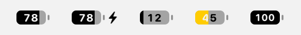
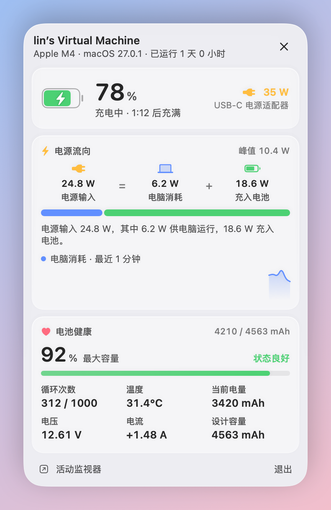

<p align="center"></p>

# Status

A lightweight native macOS menu bar system monitor built with SwiftUI. It needs no Xcode; Command Line Tools is enough to build it.


## Download

Download `Status-x.x.dmg` from [Releases](https://github.com/fancyecho/MacStatus/releases/latest), open it, and drag Status into Applications. It's a universal app (Apple Silicon + Intel) and needs macOS 14 or later.

The app isn't notarized by Apple, so the first launch will say it "can't verify the developer". Either:

- open **System Settings → Privacy & Security**, find the note about Status at the bottom, and click **Open Anyway**; or
- run this once in Terminal:

```bash
xattr -dr com.apple.quarantine /Applications/Status.app
```

## Build from source

```bash
./build.sh            # builds into build/Status.app
./build.sh --install  # copies to /Applications and launches it
./build.sh --dmg      # packages build/Status-<version>.dmg
scripts/make-icon.sh  # regenerates the app icon (after editing scripts/make-icon.swift)
```

## Features

- **Menu bar**: CPU, CPU temperature, memory, GPU, network speed and battery, each toggled independently. It is rendered as a template image, so it adapts to light and dark menu bars automatically.
- **Panel**: a glass panel attached under the menu bar icon (Liquid Glass on macOS 26 and later, frosted glass on earlier versions). Click the icon to open or close it; clicking elsewhere or pressing Esc also closes it, and ⌘, opens settings. CPU (history curve, per-core bars, temperature), memory (app / wired / compressed / swap breakdown; a badge appears only when memory pressure is high), GPU, disk (free space, read/write speed), network (mirrored up/down chart), battery (health, cycle count, temperature, power draw), and top 5 processes by CPU or memory. Hover over a chart to read the value at any moment; right-click a process to reveal it in Finder, switch to it or quit it. The panel unfolds from the menu bar, cards settle in one after another, and switching pages resizes the glass in one smooth motion (only cross-fades when Reduce Motion is on).
- **Claude network diagnostics** (click the network card): the actual exit observed by `claude.ai/cdn-cgi/trace`, Net.Coffee reference trust score, residential / datacenter / mobile classification, country / city / ASN / operator, risk flags, and separate HTTPS checks for Claude web, Anthropic API, and the Anthropic website. It also flags differences between the web and API exits. The original live rates and traffic chart remain in the overview.
- **Battery details** (click the battery card): time to full (or to the charge limit) / estimated time remaining, power flow (adapter input = computer consumption + power into the battery), computer power history (energy flows between the icons as moving dots, faster at higher power), the **last 24 hours of battery level** (recorded every 5 minutes, charging periods shaded, kept across restarts), **Bluetooth peripheral batteries** (AirPods left / right / case, Magic Mouse, Keyboard and Trackpad), max capacity / health, cycle count, temperature, voltage, current, and capacity in mAh. The battery turns yellow in Low Power Mode.
- **Menu bar battery icon**: the percentage sits inside the battery, with a bolt beside it while charging and a yellow fill in Low Power Mode.

<p align="center"></p>
- **Network quality**: the network card shows Wi-Fi signal (as bars) and link rate, plus round-trip latency to your router and to the internet. Internet latency is the fastest of several anycast DNS servers (Cloudflare, Google, Quad9, AliDNS), so it reflects your nearest well-connected node wherever you are. Hover for signal in dBm, noise, SNR, channel and every target's latency. Latency is only measured while the panel is open.
- **Alerts**: system notifications when the battery drops to 20% and 10%, the CPU stays above 95°C for a minute, memory pressure becomes critical, the startup disk has less than 10 GB free, or a process keeps a full core busy for 5 minutes. Each can be turned off in Settings, and each has a cooldown so it doesn't repeat.
- **Appearance**: choose the font in Settings: Geist (the default, bundled under the SIL Open Font License, see `Resources/Fonts/Geist-OFL.txt`), SF Pro, SF Rounded, SF Mono, DIN or New York. Geist and Rounded apply to the whole interface; the others change the numbers only.
- **Languages**: Chinese and English. By default it follows the system language; you can also pick one in Settings.
- **Settings**: refresh interval of 1/2/3/5 seconds, charge limit (Auto follows the system's estimate; manual values only affect the charge-time estimate and don't change actual charging), launch at login.
- **Updates**: checks this repo's GitHub Releases for new versions (at most once a day, only when the panel opens); a new version downloads with one click.

<p align="center"><br><sub>Battery details page (sample data)</sub></p>

GPU, battery and temperature hide automatically when the data isn't available (for example in a virtual machine or on a desktop Mac). Temperature reads Apple Silicon's HID temperature sensors (M1/M2 use the pACC/eACC sensors, newer chips use the PMU die temperature); there is no public API for this, so it is loaded dynamically, and if a future system changes it, it simply won't be shown.

## Resource usage

The panel only refreshes the UI while it's open. While closed, only what the menu bar shows is sampled (GPU, disk, and the process list stop sampling). The menu bar icon is drawn directly with Core Graphics and redrawn only when the displayed content changes, and the timer allows the system to coalesce wakeups.

## Debug

```bash
STATUS_SNAPSHOT=/some/dir build/Status.app/Contents/MacOS/Status  # renders the panel to PNGs and exits
STATUS_CHECK_PANEL=1 build/Status.app/Contents/MacOS/Status        # opens the panel, checks position, height stability and click-to-close
STATUS_SHOW_PANEL=3 build/Status.app/Contents/MacOS/Status         # only opens the panel for 3 seconds (no synthetic clicks), for screenshots; add STATUS_APPEARANCE=dark/light to force an appearance
STATUS_SLOW_MOTION=8 STATUS_PAGES=battery,overview STATUS_SHOW_PANEL=20 build/Status.app/Contents/MacOS/Status  # slows panel animations 8x and switches pages every 2 s (STATUS_PAGE_EVERY), to check animations frame by frame
STATUS_DEMO=1 build/Status.app/Contents/MacOS/Status              # fills GPU / temperature / battery with simulated data to check layout
/Applications/Status.app/Contents/MacOS/Status --battery-info   # prints the raw battery fields and how they were parsed (no serial numbers)
/Applications/Status.app/Contents/MacOS/Status --check-update   # checks for updates once and prints the result
```

## Claude network diagnostics

The network card opens a native detail page using the same cards, typography, palette and glass panel as the rest of Status. Refresh manually or choose Off / 1 / 5 / 15 minutes (default: 5 minutes). Automatic checks only run while this page is open; leaving it or closing the panel cancels pending checks. IP hiding is remembered, and visible addresses can be copied.

- **Exit measurement**: Status requests each target's `https://<host>/cdn-cgi/trace` with cache bypass. Only a valid IP in a trace with a matching host is accepted. A failed Claude trace remains unknown; another website's public IP is never substituted. The main score and properties apply to the Claude web exit. If the API exit differs, it is shown separately.
- **IP intelligence**: the GET endpoints `https://ip.net.coffee/api/iprisk/<IP>` and `/api/geoip/<IP>` are those used by the [Net.Coffee Claude page](https://ip.net.coffee/claude/) (checked 2026-10-24). They are website endpoints, with no documented stability guarantee. The app sends the detected exit IP to this provider. DNS checks additionally use randomized subdomains under `d.ip.net.coffee` and its `/api/dns/result/<token>` endpoint. It does not load the page, its analytics, or its session-reporting code. No login, browser cookies or chat content are read.
- **Scoring**: the score and 95 / 80 / 50 / 25 thresholds come from Net.Coffee. This is a third-party IP rating, not an Anthropic score or a promise of account safety. Status does not invent a score or replace the provider's score with a guessed regional penalty. Data unavailable, malformed or out of range stays unknown. Residential classification requires explicit data; a negative datacenter flag alone is not sufficient.
- **Freshness and limits**: traces are requested afresh each time. Successfully fetched intelligence is cached in memory for 10 minutes for the same IP, with its original fetch time shown. A changed IP cannot inherit the previous IP's score. The provider may additionally cache its own data. A 429 response pauses intelligence retries for 10 minutes while connectivity checks continue.
- **Availability**: the checks distinguish HTTP success, authentication required, forbidden/restricted access, rate limits, server errors, redirects, timeouts and connection failure. Durations measure the whole HTTPS request, not ICMP Ping. Receiving a response does not establish that login or an authenticated API call will work.
- **Routing scope**: these are Status's requests using macOS networking. Per-app / per-process proxy rules can route Claude Desktop or Claude Code differently. The results are not a measurement of those processes. IPv6 remains enabled.

Verification:

```bash
swift test
build/Status.app/Contents/MacOS/Status --check-network
STATUS_NETWORK_LIVE=1 STATUS_SNAPSHOT=/some/dir build/Status.app/Contents/MacOS/Status
STATUS_PAGE=network STATUS_SHOW_PANEL=30 build/Status.app/Contents/MacOS/Status
```

`STATUS_NETWORK_FIXTURE=residential|ipv6|blocked|partial|unknown|zero` is an offline screenshot mode. It uses reserved documentation IPs, labels the page as a demo, and makes no diagnostic requests. Existing overview / battery / settings / menu bar snapshots are still produced; `network-light.png` and `network-dark.png` are added.

### DNS / WebRTC and interface refinements

- Settings → Network diagnostics → **Claude IP 出口检测** enables or disables the detail page. Disabling hides the entry and immediately cancels probes; local throughput monitoring continues normally. The choice is remembered (default: enabled).
- DNS checks trigger two random hostnames, read the authoritative DNS observations, and show the actual resolver IPs. All observed resolvers receive region lookups through the site's batch endpoint (16 per request), with individual fallback and a one-hour in-memory region cache. Mainland China resolvers are flagged as leaks and shown first. Foreign-country differences alone are not flagged. Unknown regions keep the overall result unconfirmed. All observed IPs are retained and can be expanded in the UI. An empty result is unknown, not evidence of encrypted or leak-free DNS.
- WebRTC checks create a short-lived, nonpersistent local WebKit document, then run an actual RTCPeerConnection data channel with Google / Cloudflare STUN. Only public UDP candidates are compared to the Claude exit. IPv4 and IPv6 are supported; local / private / documentation ranges are excluded correctly. The WebView and peer connection are released after completion or cancellation. No microphone or camera permission is requested. WebKit privacy policies or blocked STUN may yield no public candidate; the UI then explicitly says it cannot confirm the UDP exit.
- Refresh intervals and charge-limit estimates use compact glass menus that show the current value and expand on click. Process sorting retains its compact buttons. Network auto-check timing is a compact menu in the title row. The network scroll viewport hides scroll indicators, retains normal scrolling, has rounded corners and fades only at overflowing edges; there is no fixed bottom control area.
- Status now uses an AppKit menu-bar lifecycle with its existing SwiftUI panel. The former empty `Settings { EmptyView() }` scene is removed, so launch creates no empty settings window. Reopening the app shows the existing status panel.

`STATUS_CHECK_STARTUP=1 build/Status.app/Contents/MacOS/Status` verifies that no app content window is visible immediately after launch (menu-bar icon windows are expected). `--check-network` also prints DNS and WebRTC results. Screenshots now include `settings-dark.png`.

DNS labels use country/region codes: CN = 中国大陆, HK = 中国香港, MO = 中国澳门, TW = 中国台湾. Only CN triggers the mainland DNS rule. A mixed US/Singapore resolver set is therefore shown as 未检测到泄露, while any unresolved location remains 地区未完全确认. WebRTC still compares all public UDP candidates with the Claude exit; absent candidates remain unconfirmed.
