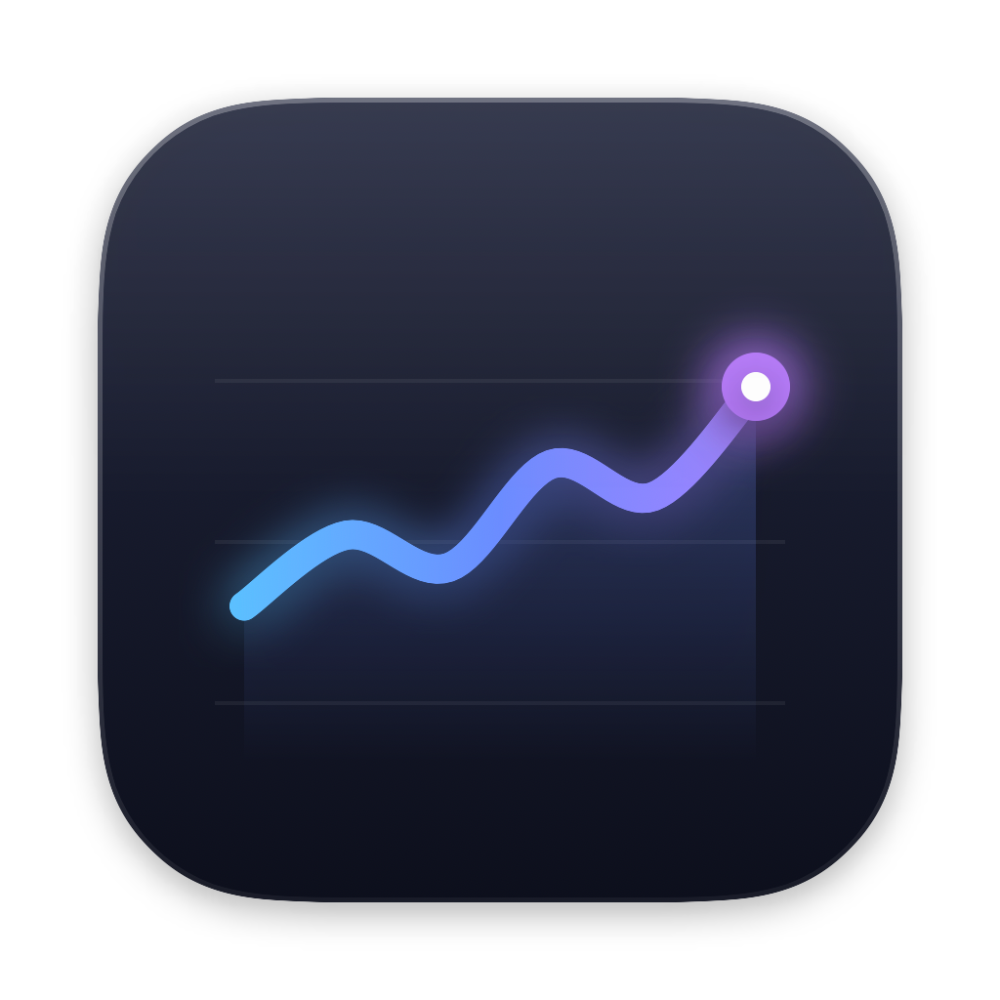
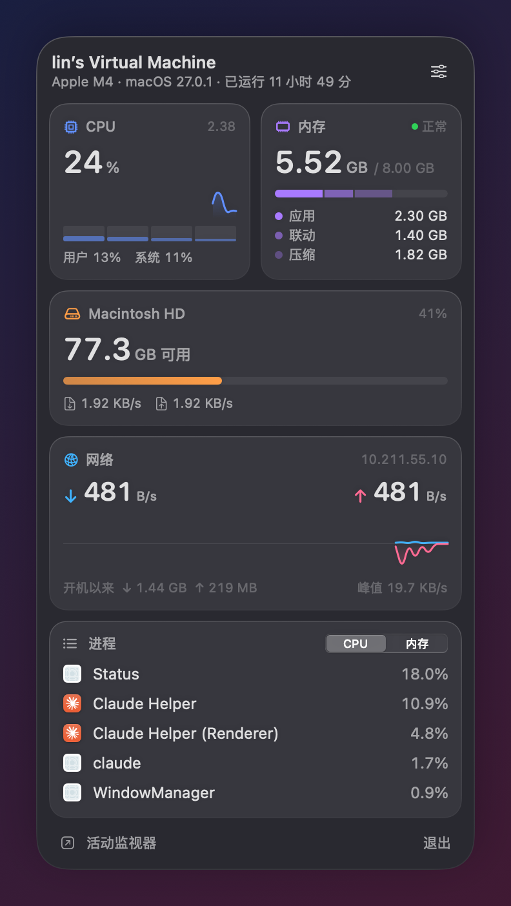

<p align="center"></p>

# Status

A lightweight native macOS menu bar system monitor built with SwiftUI. It needs no Xcode; Command Line Tools is enough to build it.



## Download

Download `Status-x.x.dmg` from [Releases](https://github.com/fancyecho/MacStatus/releases/latest), open it, and drag Status into Applications. It's a universal app (Apple Silicon + Intel) and needs macOS 14 or later.

The app isn't notarized by Apple, so the first launch will say it "can't verify the developer". Either:

- open **System Settings → Privacy & Security**, find the note about Status at the bottom, and click **Open Anyway**; or
- run this once in Terminal:

```bash
xattr -dr com.apple.quarantine /Applications/Status.app
```

## Build from source

```bash
./build.sh            # builds into build/Status.app
./build.sh --install  # copies to /Applications and launches it
./build.sh --dmg      # packages build/Status-<version>.dmg
scripts/make-icon.sh  # regenerates the app icon (after editing scripts/make-icon.swift)
```

## Features

- **Menu bar**: CPU, CPU temperature, memory, GPU, network speed and battery, each toggled independently. It is rendered as a template image, so it adapts to light and dark menu bars automatically.
- **Panel**: a frosted-glass panel attached under the menu bar icon (Esc or clicking outside closes it). CPU (history curve, per-core bars, temperature), memory (app / wired / compressed breakdown, memory pressure), GPU, disk (free space, read/write speed), network (mirrored up/down chart), battery (health, cycle count, temperature, power draw), and top 5 processes by CPU or memory.
- **Settings**: refresh interval of 1/2/3/5 seconds, launch at login.

GPU, battery and temperature hide automatically when the data isn't available (for example in a virtual machine or on a desktop Mac). Temperature reads Apple Silicon's HID temperature sensors (M1/M2 use the pACC/eACC sensors, newer chips use the PMU die temperature); there is no public API for this, so it is loaded dynamically, and if a future system changes it, it simply won't be shown.

## Resource usage

The panel only refreshes the UI while it's open. The menu bar redraws only when the displayed numbers change, and slow queries (disk capacity, process list) run less often. With the panel closed, CPU usage is about 0.3%.

## Debug

```bash
STATUS_SNAPSHOT=/some/dir build/Status.app/Contents/MacOS/Status  # renders the panel to PNGs and exits
STATUS_CHECK_PANEL=1 build/Status.app/Contents/MacOS/Status        # opens the panel and prints its position relative to the menu bar icon
```
